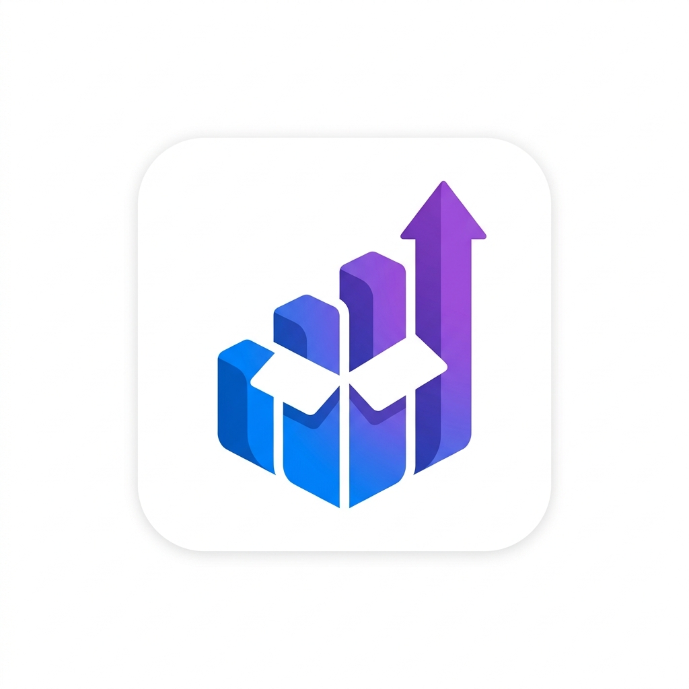

<div align="center">
  

  <h1>SmartStock</h1>

  <p>Hệ thống Web và App quản lý bán hàng, tồn kho, tài chính và cảnh báo nghĩa vụ thuế cho cửa hàng và hộ kinh doanh.</p>

  <p>
    <a href="https://smartstock-tax.vercel.app/">Mở SmartStock Web</a>
  </p>
</div>

**SmartStock** là hệ thống gồm **phiên bản Web** và **ứng dụng di động (App Android)** cùng vận hành song song, kết nối chung một REST API Express/TypeScript và cơ sở dữ liệu PostgreSQL. Cả Web và App được xây dựng từ cùng một mã nguồn Flutter để đồng bộ nghiệp vụ và dữ liệu theo thời gian thực — phù hợp cho việc vừa bán hàng, quét mã, kiểm kho nhanh trên điện thoại vừa theo dõi báo cáo, tài chính, sơ đồ kho và kê khai thuế trên trình duyệt. Hệ thống hỗ trợ quản lý **đa cửa hàng**, phân quyền chi tiết theo vai trò cho nhân viên và tổng hợp số liệu ở chế độ xem toàn bộ cửa hàng (*All Shops*).

---

## Chức năng chính

| Nhóm nghiệp vụ | Tính năng nổi bật |
| --- | --- |
| **Bán hàng (POS & Đơn hàng)** | Tìm sản phẩm theo tên, SKU hoặc mã vạch; lập đơn bán nhanh; thanh toán tiền mặt, chuyển khoản **VietQR** (tạo mã theo số tiền và mã đơn, ghi nhận khi người dùng xác nhận đã nhận tiền) hoặc ghi công nợ; đọc thông báo giọng nói và âm báo riêng theo phương thức thanh toán; trả từng mặt hàng theo số lượng; cấu hình đơn vị vận chuyển & phí giao hàng (Cửa hàng trả / Khách trả); xuất và in hóa đơn PDF theo mẫu tùy chỉnh. |
| **Kho hàng & Mặt bằng kho** | Quản lý danh mục, thẻ tag, nhập/xuất Excel danh mục; lập phiếu nhập hàng, gợi ý nhập hàng, quản lý nhiều kho, lô hàng và hạn dùng (cảnh báo cận date, hàng bán chậm, tồn dưới định mức tối thiểu); kiểm kê kho trực quan; báo cáo **Xuất – Nhập – Tồn (XNT)** có xuất Excel; tính giá vốn hàng bán (**COGS**) theo **FIFO** hoặc **Bình quân gia quyền (AVG)**. |
| **Sơ đồ kệ & Mượn hàng liên kho** | Thiết kế mặt bằng kho dạng lưới kéo-thả (kệ, lối đi, cửa, khu nhận/giao hàng, vách ngăn, pallet, tủ mát, bàn trưng bày, quầy, hàng cồng kềnh) có hoàn tác, phóng to/thu nhỏ, gán vị trí `Kệ · Tầng · Ô` và tra cứu nhanh vị trí sản phẩm. Hỗ trợ liên kết cửa hàng đối tác theo mã cửa hàng, tạo phiếu mượn/cho mượn hàng, xuất kho nhiều đợt và xác nhận nhận/hoàn hàng. |
| **Tài chính & Kế toán hộ kinh doanh** | Thiết lập **Số dư đầu kỳ** (tiền mặt, tiền gửi/chuyển khoản, tồn kho, công nợ đầu kỳ); sổ thu chi, sổ lương, giao dịch mua hàng không hóa đơn; báo cáo lãi/lỗ; đối soát tiền mặt kết ca hàng ngày; theo dõi công nợ và tuổi nợ phải thu/phải trả; lập kế hoạch ngân sách và dự báo dòng tiền. |
| **Hóa đơn & OCR** | Lưu trữ chứng từ nội bộ; quét và trích xuất thông tin từ ảnh hóa đơn bằng **Gemini AI** để người dùng kiểm tra, đối chiếu trước khi lưu chứng từ hoặc chuyển thành phiếu nhập hàng. |
| **Thuế & Trợ lý AI** | Cấu hình ngành nghề và chính sách thuế lưu trong cơ sở dữ liệu; theo dõi nghĩa vụ thuế, ước tính thuế theo tháng/quý và cảnh báo tiệm cận ngưỡng doanh thu/hóa đơn điện tử; hỗ trợ xuất tờ khai **XML** (để kiểm tra, đối chiếu trên công cụ kê khai phù hợp như HTKK) và **PDF** (Mẫu 01/CNKD). Tích hợp Trợ lý AI (Gemini) trả lời dựa trên dữ liệu cửa hàng và kho tài liệu tri thức có thể quản trị ngay trong ứng dụng. |
| **Quản trị, Bảo mật & Sao lưu** | Quản lý nhân viên, vai trò và quyền hạn theo cửa hàng; nhật ký hoạt động; cấu hình tài khoản nhận tiền/VietQR, mẫu hóa đơn, đơn vị vận chuyển; **Sao lưu & khôi phục** dữ liệu riêng từng cửa hàng qua gói `.smartstock-backup.gz` có checksum (không chứa mật khẩu, token hay file ảnh gốc) kèm kiểm tra chênh lệch và hỗ trợ rollback; hỗ trợ giao diện **Tiếng Việt / Tiếng Anh** và chế độ **Sáng / Tối**. |

> **Lưu ý nghiệp vụ & pháp lý:** Kết quả OCR hóa đơn, câu trả lời từ Trợ lý AI, số thuế ước tính và tệp xuất XML/PDF chỉ mang tính hỗ trợ đối chiếu theo cấu hình hiện tại; người dùng cần kiểm tra lại chứng từ thực tế và quy định pháp luật hiện hành trước khi ghi sổ hoặc nộp kê khai chính thức. Ngoài ra, chế độ ghi nhận chứng từ offline đã ngừng hỗ trợ ở API (`/sync/operations`) để đảm bảo tính nhất quán dữ liệu trực tuyến.

---

## Kiến trúc và công nghệ

- **Frontend (`lib/`)**: Flutter & Dart (`^3.11.0`), dùng chung cho Web và Android.
  - Quản lý trạng thái: `flutter_riverpod`
  - Điều hướng & phân quyền theo route: `go_router`
  - Giao tiếp API: `dio`
  - Biểu đồ, bản đồ, in ấn & tiện ích: `fl_chart`, `flutter_map`, `pdf`, `printing`, `file_picker`, `file_saver`, `flutter_tts`, `audioplayers`, `flutter_markdown`, `google_sign_in`, `flutter_secure_storage`, `shared_preferences`.
- **Backend (`backend/`)**: Node.js, Express 5, TypeScript, TypeORM, PostgreSQL theo kiến trúc phân lớp `routes -> controllers -> services -> entities`.
  - Xác thực & bảo mật: JWT (`access` / `refresh`), Google OAuth (`google-auth-library`), `bcrypt`, `helmet`, `cors`, `express-rate-limit`, `zod`.
  - Tích hợp ngoài: `@google/generative-ai` (Gemini AI với cơ chế fallback qua các model/quota khả dụng), `cloudinary` (lưu trữ ảnh), `nodemailer` / eSMS / Twilio (gửi OTP), `sharp` / `jsqr`.
- **Cơ sở dữ liệu (`backend/database/`)**: Lược đồ PostgreSQL gốc ([QLKH.sql](backend/database/QLKH.sql)) cùng các script SQL cập nhật và thư mục `migrations/`.

### Cấu trúc thư mục chính

```text
lib/                    Mã nguồn Flutter (core/, features/, giao diện, state, API client)
backend/src/            REST API Express/TypeScript (routes, controllers, services, entities, scripts)
backend/database/       Lược đồ PostgreSQL, file SQL cập nhật và migrations/
backend/test/           Bộ kiểm thử đơn vị & nghiệp vụ backend (node --test)
test/                   Bộ kiểm thử widget & unit Flutter
assets/                 Tài nguyên ảnh, biểu tượng, sơ đồ kho (assets/warehouse/), phông chữ, âm báo
android/                Cấu hình build ứng dụng Android
web/                    Điểm khởi chạy và tài nguyên bản Flutter Web
scripts/                Script hỗ trợ kiểm tra gói build web và xác minh
```

---

## Cài đặt và chạy cục bộ

### Yêu cầu môi trường

- **Flutter SDK** tương thích với ràng buộc Dart `^3.11.0` trong [pubspec.yaml](pubspec.yaml).
- **Node.js** phiên bản 22.13 trở lên (nhánh 22) hoặc Node.js 24.
- **PostgreSQL** đã khởi tạo lược đồ SmartStock và áp dụng các migration cần thiết (`DB_SYNC=false` là mặc định, TypeORM không tự động tạo lại lược đồ khi khởi động).

### 1. Chạy Backend API

Từ thư mục gốc của dự án, mở PowerShell:

```powershell
Set-Location backend
Copy-Item .env.example .env
npm.cmd ci
```

Cập nhật các biến môi trường trong `backend/.env` theo mẫu [backend/.env.example](backend/.env.example):
- **Bắt buộc**: `DATABASE_URL` (hoặc `DB_HOST`, `DB_DATABASE`), và trên môi trường production phải cấu hình 3 secret khác nhau dài tối thiểu 32 byte cho `ACCESS_TOKEN_SECRET`, `REFRESH_TOKEN_SECRET`, `OTP_SECRET`.
- **Tùy chọn theo tính năng**: `GOOGLE_CLIENT_IDS` (Google Sign-In), `CLOUDINARY_*` (upload ảnh), `GEMINI_API_KEY` (OCR hóa đơn & Trợ lý AI), `SMTP_USER`/`SMTP_PASS` hoặc `ESMS_*`/`TWILIO_*` (OTP).

Khởi chạy server phát triển:

```powershell
npm.cmd run dev
```

API mặc định lắng nghe tại `http://localhost:8080/api/`.

### 2. Chạy Web & App (Flutter Web / Android)

Mở cửa sổ lệnh mới tại thư mục gốc để chạy bản Web hoặc App kết nối cùng Backend API trên:

```powershell
flutter pub get

# Chạy phiên bản Web trên Chrome
flutter run -d chrome --dart-define=API_URL=http://localhost:8080/api/

# Hoặc chạy App trên thiết bị / máy ảo Android đang kết nối
flutter run --dart-define=API_URL=http://localhost:8080/api/
```

- Nếu chạy trên **Android Emulator** trỏ về backend cục bộ, `ApiClient` tự động ánh xạ `localhost` / `127.0.0.1` sang `10.0.2.2`.
- Nếu dùng **Google Sign-In** trên web hoặc mobile, truyền thêm `--dart-define=GOOGLE_WEB_CLIENT_ID=...` (hoặc `GOOGLE_SERVER_CLIENT_ID` / `GOOGLE_IOS_CLIENT_ID`) và khai báo origin được phép trong Google OAuth Console.

---

## Kiểm tra & xác minh

**Frontend:**

```powershell
dart format --output=none --set-exit-if-changed lib test
flutter analyze
flutter test
```

**Backend:**

```powershell
Set-Location backend
npm.cmd run build
npm.cmd run lint
npm.cmd run test:p0
```

> Một số script kiểm thử, audit và seed dữ liệu trong [backend/package.json](backend/package.json) (như `test:permissions`, `test:tax`, `test:auth`, `test:data-quality`, `audit:*`, `seed:*`) yêu cầu cơ sở dữ liệu hoặc dữ liệu mẫu cục bộ tương ứng.

---

## Triển khai Production (Vercel)

Hệ thống hiện đã được triển khai thực tế trên **Vercel** theo mô hình 2 project từ cùng một repository:

- **Web Production**: `https://smartstock-tax.vercel.app/`
- **Backend API Production**: `https://stock-management-and-tax-warning.vercel.app/api/`

Trên môi trường production, trang Web sử dụng cơ chế rewrite `/api/:match*` trong [vercel.json](vercel.json) để chuyển tiếp yêu cầu API sang Backend Vercel (kèm fallback SPA về `/index.html`), đồng thời bản App Android cũng có thể kết nối trực tiếp vào cùng domain API này thông qua `--dart-define=API_URL=...` để Web và App dùng chung một cơ sở dữ liệu PostgreSQL.

### Quy trình triển khai

1. **Chuẩn bị PostgreSQL**: Đảm bảo cơ sở dữ liệu production đã khởi tạo lược đồ và chạy đầy đủ các file migration trong `backend/database/` và `backend/database/migrations/`.
2. **Triển khai Backend API**: Tạo project Vercel với **Root Directory** là `backend`, triển khai theo [backend/vercel.json](backend/vercel.json) (region `sin1`, runtime `@vercel/node`). Cấu hình đầy đủ biến môi trường theo [backend/.env.example](backend/.env.example), trong đó lưu ý:
   - `ACCESS_TOKEN_SECRET`, `REFRESH_TOKEN_SECRET` và `OTP_SECRET` phải là 3 chuỗi bí mật khác nhau, dài tối thiểu 32 byte khi `NODE_ENV=production`.
   - Đặt `OTP_DEBUG_RESPONSE=false` và khai báo `ALLOWED_ORIGINS` bao gồm domain Web production.
3. **Triển khai Flutter Web**: Tạo project Vercel tại thư mục gốc repo. File [vercel.json](vercel.json) sẽ gọi [build_vercel.sh](build_vercel.sh) để build bản `--release` vào `build/web` và tự động chạy `scripts/verify-web-auth-build.cjs`, `scripts/verify-web-plugin-build.cjs` để kiểm tra gói build. Nếu đổi domain Backend API, cập nhật đích rewrite `/api/:match*` trong [vercel.json](vercel.json) hoặc cấu hình biến `API_URL`.
4. **Cấu hình Google Sign-In (nếu dùng)**: Đặt `GOOGLE_WEB_CLIENT_ID` cho bản Web, thêm client ID vào `GOOGLE_CLIENT_IDS` ở Backend và khai báo domain `https://smartstock-tax.vercel.app` vào Authorized JavaScript origins trên Google OAuth Console.
